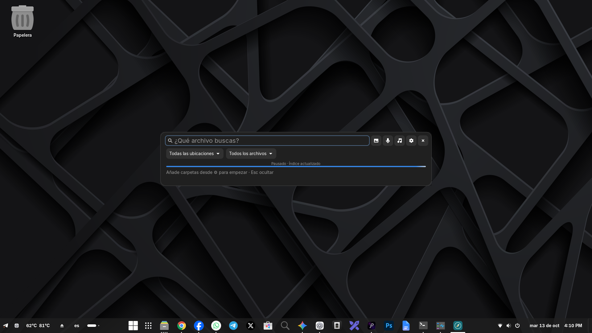
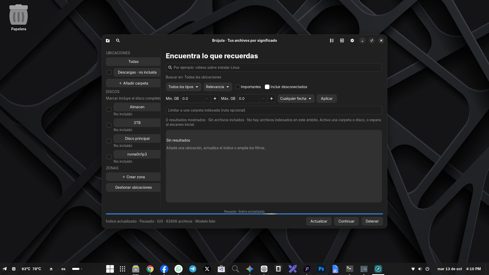

# Brújula

**Encuentra tus archivos por lo que contienen, no solo por su nombre.**

Brújula es un buscador local para Linux, desarrollado y probado en **Zorin OS 18.1**. Usa **EmbeddingGemma 2** para comparar texto, imágenes y audio con el contenido de tus archivos. Una barra emergente sirve para buscar; una ventana independiente permite gestionar ubicaciones, discos y recursos.

## Así se ve

### Buscador emergente



Texto, imagen pegada o arrastrada, archivo de audio o una consulta grabada con el micrófono. Las imágenes adjuntas se muestran como miniaturas. Cuando hay resultados, el panel se amplía con una lista y una vista previa.

### Gestión de ubicaciones



Las capturas muestran la aplicación real con el índice pausado y sin ubicaciones activas para esa búsqueda. Los discos detectados no se incluyen automáticamente.

## Funciones

- Búsqueda por significado, nombre y texto extraído.
- Barra emergente con entrada de texto, imagen y audio; admite texto más una referencia multimedia.
- Miniaturas de imágenes, fotogramas de video y primera página de PDF.
- Filtros por disco, carpeta, zona, tipo, tamaño, fecha e importancia manual.
- Casillas para incluir discos completos o carpetas; estados **No incluido**, **Parcial** y **Incluido completo**.
- Índice persistente e incremental: procesa archivos nuevos o modificados y conserva el resto.
- Barra de progreso, pausa, reanudación, actividad y reintento de errores.
- Indexación condicionada al uso y memoria libre de la GPU NVIDIA, con intervalos configurables.
- Muestreo acotado de videos y documentos largos, en lugar de analizar todo exhaustivamente.
- Procesamiento local; las consultas y los archivos indexados no se envían a una API.

## Instalación como aplicación (.deb)

La release **v0.2.0** incluye `brujula_0.2.0_all.deb` y su SHA-256. Instala con:

```bash
sudo apt install ./brujula_0.2.0_all.deb
brujula
```

El paquete instala el código, icono y lanzador. **El modelo y el motor de IA se preparan por separado**, desde el botón **Preparar IA** de la primera apertura; puedes elegir CPU o NVIDIA/CUDA. No hay descargas en scripts de dpkg ni datos personales en el paquete.

La aplicación sigue siendo editable desde el repositorio. [Instalación, datos, construcción y desarrollo](docs/PAQUETE_DEB.md).

## Instalación desde código

Necesitas Linux, Python 3.12 o posterior para el motor, GTK 4/libadwaita con PyGObject en el Python del sistema, y `uv`. CUDA es opcional; también puedes elegir CPU.

En Zorin OS/Ubuntu, instala las dependencias del escritorio:

```bash
sudo apt install python3-gi gir1.2-gtk-4.0 gir1.2-adw-1 \
  python3-venv ffmpeg poppler-utils pipewire-bin pipx
```

Clona el repositorio y prepara el entorno:

```bash
git clone https://github.com/Maxdesigna7x/brujula.git
cd brujula
pipx install uv
export PATH="$HOME/.local/bin:$PATH"
./scripts/setup.sh
.venv/bin/python scripts/download_model.py
.venv/bin/python scripts/check_runtime.py
./run.sh
```

`setup.sh` crea un entorno virtual. Si ya tienes PyTorch y las bibliotecas base en tu Python, las reutiliza mediante `system-site-packages`; en una instalación nueva descarga las dependencias indicadas en `requirements.txt`. PyTorch/CUDA puede requerir una descarga grande.

El modelo se descarga por separado, con reintentos y reutilización de archivos existentes. Sus pesos BF16 ocupan aproximadamente **1,49 GB**, más configuración y tokenizador. **El repositorio no incluye pesos, entorno virtual ni índices personales.**

Para instalar el lanzador y el atajo de teclado:

```bash
.venv/bin/python scripts/install_desktop.py
/usr/bin/python3 scripts/install_shortcut.py
```

El atajo propuesto es **Ctrl+Alt+Espacio**. El instalador conserva los otros atajos personalizados y rechaza conflictos con ellos. Puedes cambiarlo en la configuración de teclado de Zorin.

## Primer uso

1. Abre ⚙ y pulsa **Añadir carpeta**: escribe una ruta, usa **Añadir Descargas** o examina carpetas.
2. También puedes marcar un disco completo. No hay ubicaciones incluidas por defecto.
3. Espera al escaneo y análisis. La GPU ocupada deja el trabajo pendiente hasta que cumpla los límites configurados.
4. Abre la barra y escribe una descripción, pega/arrastra una imagen o adjunta/graba audio.
5. Usa **↑/↓** para seleccionar, **Enter** para abrir, **Ctrl+Enter** para mostrar la carpeta y **Esc** para ocultar.

**Ocultar el panel no cierra la aplicación.** Brújula sigue revisando cambios mientras su proceso está activo. Para detenerlo, usa **Salir de Brújula** en la ventana de gestión. No se instala un servicio de inicio de sesión.

Para una prueba pequeña, añade la carpeta `examples/` y busca “cómo instalar un sistema operativo”.

## Datos y privacidad

- Índice, configuración y registros: `~/.local/share/brujula/`.
- Miniaturas: `~/.local/share/brujula/thumbnails/`.
- Modelo: `~/.local/share/brujula/models/embeddinggemma-2/` con el paquete; se reutiliza `models/embeddinggemma-2/` si existe en el checkout.
- Audio e imágenes de consulta se convierten en archivos temporales; no se añaden automáticamente al índice.
- La aplicación lee los originales; no los modifica, mueve ni sube.
- El índice contiene rutas, muestras textuales y embeddings. Trátalo como información personal.

Desmarcar una carpeta o disco lo excluye del análisis y la búsqueda, conservando su índice. Quitar una ubicación desde la gestión elimina sus registros, nunca sus archivos originales.

## Alcance actual

Esta es una **primera versión experimental**. El .deb está orientado a Zorin OS 18 / Ubuntu 24.04; no se ha probado en todas las distribuciones.

- Un adjunto multimedia por consulta: una segunda imagen o audio sustituye al primero. Texto más adjunto combina sus embeddings; no garantiza que se cumplan ambas condiciones exactamente.
- Ctrl+V acepta una imagen como contenido del portapapeles; copiar un archivo desde el administrador de archivos puede usar otro formato todavía no soportado.
- Voz como consulta semántica directa, sin transcripción. La relevancia de voz en español todavía requiere evaluación con grabaciones reales.
- Sin OCR, resúmenes generativos, seguimiento universal de uso ni integración GNOME Shell/Nautilus.
- Videos y documentos largos se muestrean: pueden omitirse temas. Abrir un video no salta automáticamente al fotograma coincidente.
- Comparación vectorial directa; bibliotecas de millones de segmentos requieren nuevas mediciones y optimizaciones.

## Desarrollo y pruebas

```bash
.venv/bin/python -m unittest discover -s tests -v
.venv/bin/python scripts/check_runtime.py
.venv/bin/python scripts/validate_model.py
.venv/bin/python scripts/benchmark.py
```

Las dos últimas órdenes requieren el modelo descargado y ejecutan inferencia real con contenido sintético. Los informes se escriben en `work/`, excluido de Git.

Se verificaron **24 pruebas** del índice, filtros, discos, consultas multimedia y control de recursos, además de comprobaciones GTK bajo Xvfb. El .deb se probó mediante instalación aislada y un motor CPU limpio; la instalación global necesita tu contraseña de administrador. Las mediciones iniciales en una RTX 3060 mostraron aproximadamente 0,55–1,58 GB de memoria GPU asignada por PyTorch y 2,38–2,79 GB de RAM residente del proceso de inferencia. Son pruebas pequeñas, no una garantía de rendimiento sobre una biblioteca real.

## Documentación

- [Guía para agentes](AGENTS.md)
- [Contexto, decisiones y pendientes](docs/CONTINUIDAD.md)
- [Desarrollo, pruebas y publicación](docs/MANTENIMIENTO.md)
- [Instalación y paquete .deb](docs/PAQUETE_DEB.md)
- [Guía de uso](docs/USO.md)
- [Arquitectura](docs/ARQUITECTURA.md)
- [Diagnóstico](docs/SOLUCION_DE_PROBLEMAS.md)
- [Validación y límites](docs/VALIDACION.md)

## Créditos

El diseño tomó como referencia [DigUp](https://github.com/ARahim3/DigUp). La implementación de Brújula usa Python y GTK; no se portó código Swift.

Modelo: [EmbeddingGemma 2 de Google](https://huggingface.co/google/embeddinggemma-2), revisión fijada `914f7f89142e33e77833254d9c9b90c3cef7303b`. Consulta las condiciones y licencias del modelo y de las dependencias por separado.
